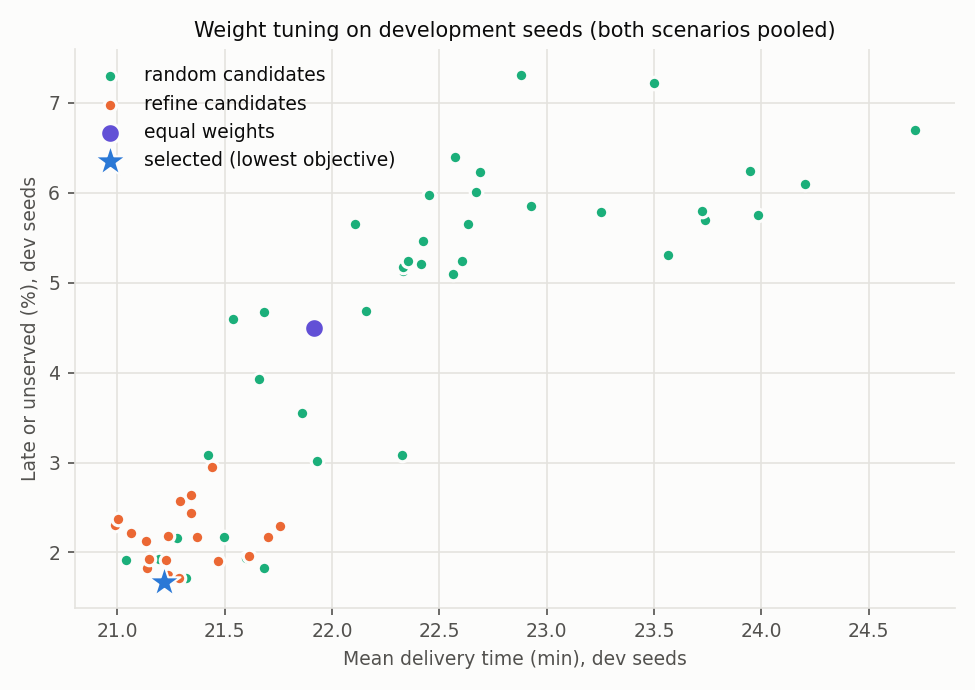
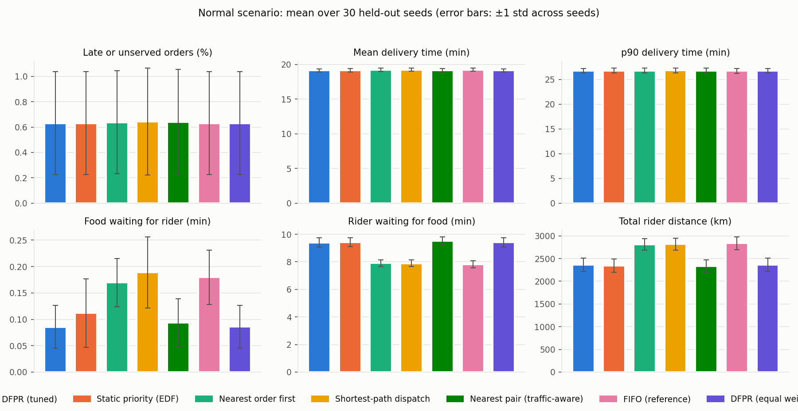
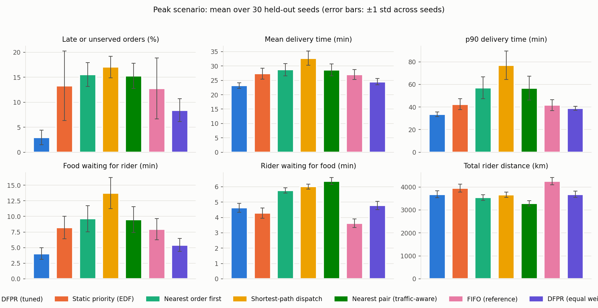
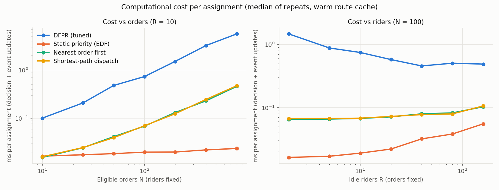
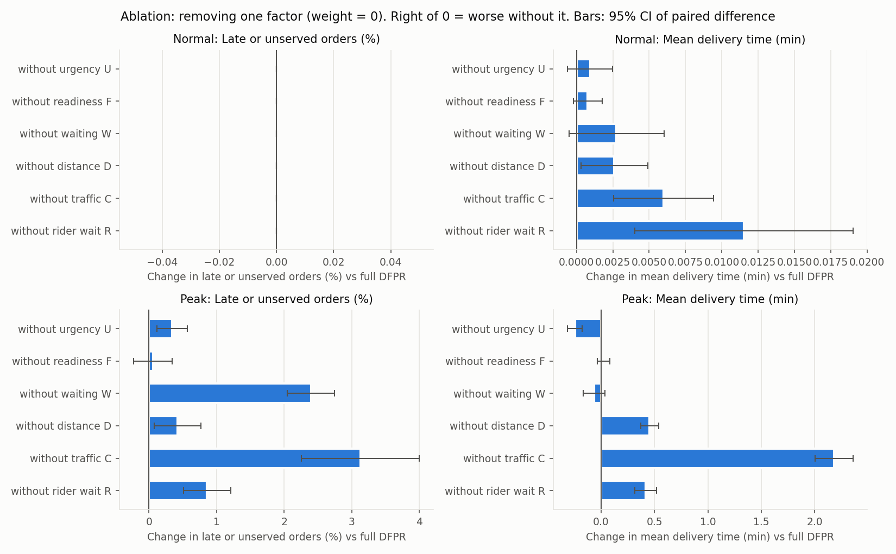
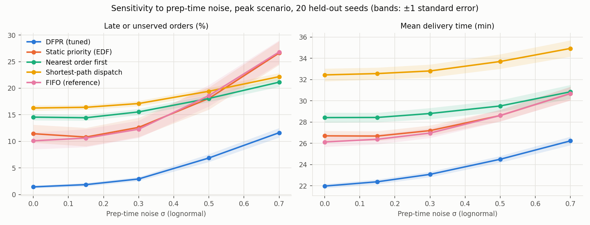

# DFPR experiment results

All numbers below are produced by `python main.py run-all` and read back from the CSV files in this folder. For every metric, **lower is better**. *Late* means delivered after the deadline **or never delivered**. Tests are paired by seed (every method sees the same orders, prep times, traffic and rider starts). p-values: exact Wilcoxon signed-rank test, Holm-corrected within each (scenario, metric) family; significance threshold 0.05. The paired t-test p-value and the 95% CI of the mean difference are also reported in `compare_tests.csv`.

## 1. Setup

| Parameter | Value |
|---|---|
| City | 25x25 grid, 200 m blocks, 3 arterials, 40 restaurants |
| Day | 10:00-22:00 + 120 min drain |
| Demand | 40 orders/h; peak scenario x2.5 at 12-14h, 19-21h |
| Riders | 18 (capacity 1) |
| Prep noise | lognormal sigma = 0.3 |
| Dev seeds (tuning) | 0-9 |
| Held-out seeds (evaluation) | 100-129 |

## 2. Weight tuning (development seeds only)

Objective (lower is better): mean over dev runs of `1.0 x late_pct + 1.0 x avg_delivery_min`. 61 candidates evaluated on both scenarios.

| Candidate | Stage | w_u | w_f | w_w | w_d | w_c | w_r | Objective | Late % | Mean delivery |
|---|---|---|---|---|---|---|---|---|---|---|
| 54 | refine | 0.50 | 0.05 | 1.80 | 0.48 | 2.30 | 2.16 | 22.886 | 1.67 | 21.22 |
| 32 | random | 0.09 | 0.06 | 0.76 | 0.75 | 0.56 | 1.70 | 22.960 | 1.92 | 21.04 |
| 53 | refine | 0.06 | 0.06 | 1.03 | 0.65 | 0.52 | 1.57 | 22.964 | 1.83 | 21.14 |
| 49 | refine | 0.10 | 0.06 | 1.29 | 0.61 | 0.49 | 0.90 | 22.989 | 1.75 | 21.23 |
| 58 | refine | 0.83 | 0.09 | 2.37 | 1.28 | 1.58 | 2.30 | 23.002 | 1.71 | 21.29 |
| 0 (equal) | random | 1.00 | 1.00 | 1.00 | 1.00 | 1.00 | 1.00 | 26.411 | 4.50 | 21.92 |

## 3. Main comparison (held-out seeds)

### Normal scenario: mean ± std over 30 seeds

| Method | Late % | Mean delivery (min) | p90 (min) | Food wait (min) | Rider wait (min) | Distance (km) | Unserved | Peak-window late % | Peak-window mean (min) |
|---|---|---|---|---|---|---|---|---|---|
| DFPR (tuned) | 0.63 ± 0.41 | 19.13 ± 0.24 | 26.76 ± 0.48 | 0.09 ± 0.04 | 9.41 ± 0.32 | 2363.08 ± 145.45 | 0.00 ± 0.00 | 0.73 ± 0.64 | 19.74 ± 0.45 |
| Static priority (EDF) | 0.63 ± 0.41 | 19.16 ± 0.25 | 26.78 ± 0.49 | 0.11 ± 0.06 | 9.43 ± 0.32 | 2345.54 ± 148.17 | 0.00 ± 0.00 | 0.73 ± 0.64 | 19.79 ± 0.48 |
| Nearest order first | 0.64 ± 0.41 | 19.22 ± 0.23 | 26.78 ± 0.49 | 0.17 ± 0.05 | 7.91 ± 0.24 | 2811.24 ± 128.50 | 0.00 ± 0.00 | 0.73 ± 0.64 | 19.86 ± 0.43 |
| Shortest-path dispatch | 0.64 ± 0.42 | 19.24 ± 0.24 | 26.83 ± 0.48 | 0.19 ± 0.07 | 7.90 ± 0.23 | 2818.30 ± 130.35 | 0.00 ± 0.00 | 0.74 ± 0.67 | 19.89 ± 0.45 |
| Nearest pair (traffic-aware) | 0.64 ± 0.42 | 19.14 ± 0.24 | 26.80 ± 0.47 | 0.09 ± 0.05 | 9.52 ± 0.28 | 2332.20 ± 135.23 | 0.00 ± 0.00 | 0.73 ± 0.64 | 19.75 ± 0.45 |
| FIFO (reference) | 0.63 ± 0.41 | 19.23 ± 0.24 | 26.75 ± 0.48 | 0.18 ± 0.05 | 7.82 ± 0.26 | 2837.37 ± 138.27 | 0.00 ± 0.00 | 0.73 ± 0.64 | 19.88 ± 0.45 |
| DFPR (equal weights) | 0.63 ± 0.41 | 19.13 ± 0.24 | 26.75 ± 0.47 | 0.09 ± 0.04 | 9.41 ± 0.32 | 2362.85 ± 145.25 | 0.00 ± 0.00 | 0.73 ± 0.64 | 19.75 ± 0.45 |

**Paired tests, DFPR (tuned) vs each method, normal scenario** (difference = DFPR - other; negative = DFPR lower = better)

| Metric | vs | Mean diff | 95% CI | DFPR W/L/T | p (Holm) | Verdict |
|---|---|---|---|---|---|---|
| Late or unserved orders (%) | Static priority (EDF) | 0.00 | [0.00, 0.00] | 0/0/30 | 1.000 | no significant difference |
| Late or unserved orders (%) | Nearest order first | -0.01 | [-0.02, 0.01] | 1/0/29 | 1.000 | no significant difference |
| Late or unserved orders (%) | Shortest-path dispatch | -0.01 | [-0.03, 0.01] | 2/0/28 | 1.000 | no significant difference |
| Late or unserved orders (%) | Nearest pair (traffic-aware) | -0.01 | [-0.02, 0.01] | 1/0/29 | 1.000 | no significant difference |
| Late or unserved orders (%) | FIFO (reference) | 0.00 | [0.00, 0.00] | 0/0/30 | 1.000 | no significant difference |
| Late or unserved orders (%) | DFPR (equal weights) | 0.00 | [0.00, 0.00] | 0/0/30 | 1.000 | no significant difference |
| Mean delivery time (min) | Static priority (EDF) | -0.03 | [-0.04, -0.01] | 26/4/0 | <0.001 | **DFPR better** |
| Mean delivery time (min) | Nearest order first | -0.08 | [-0.10, -0.07] | 30/0/0 | <0.001 | **DFPR better** |
| Mean delivery time (min) | Shortest-path dispatch | -0.10 | [-0.12, -0.09] | 30/0/0 | <0.001 | **DFPR better** |
| Mean delivery time (min) | Nearest pair (traffic-aware) | -0.01 | [-0.02, -0.00] | 20/10/0 | 0.047 | **DFPR better** |
| Mean delivery time (min) | FIFO (reference) | -0.09 | [-0.11, -0.08] | 30/0/0 | <0.001 | **DFPR better** |
| Mean delivery time (min) | DFPR (equal weights) | -0.00 | [-0.00, 0.00] | 13/10/7 | 0.560 | no significant difference |
| p90 delivery time (min) | Static priority (EDF) | -0.02 | [-0.05, 0.01] | 6/2/22 | 0.938 | no significant difference |
| p90 delivery time (min) | Nearest order first | -0.02 | [-0.05, 0.00] | 8/3/19 | 0.615 | no significant difference |
| p90 delivery time (min) | Shortest-path dispatch | -0.07 | [-0.12, -0.03] | 16/3/11 | 0.006 | **DFPR better** |
| p90 delivery time (min) | Nearest pair (traffic-aware) | -0.04 | [-0.08, 0.01] | 7/3/20 | 0.641 | no significant difference |
| p90 delivery time (min) | FIFO (reference) | 0.01 | [-0.01, 0.02] | 3/3/24 | 1.000 | no significant difference |
| p90 delivery time (min) | DFPR (equal weights) | 0.01 | [-0.01, 0.02] | 0/1/29 | 1.000 | no significant difference |
| Food waiting for rider (min) | Static priority (EDF) | -0.03 | [-0.04, -0.01] | 26/4/0 | <0.001 | **DFPR better** |
| Food waiting for rider (min) | Nearest order first | -0.08 | [-0.09, -0.07] | 30/0/0 | <0.001 | **DFPR better** |
| Food waiting for rider (min) | Shortest-path dispatch | -0.10 | [-0.12, -0.09] | 30/0/0 | <0.001 | **DFPR better** |
| Food waiting for rider (min) | Nearest pair (traffic-aware) | -0.01 | [-0.02, -0.00] | 21/9/0 | 0.044 | **DFPR better** |
| Food waiting for rider (min) | FIFO (reference) | -0.09 | [-0.10, -0.08] | 30/0/0 | <0.001 | **DFPR better** |
| Food waiting for rider (min) | DFPR (equal weights) | -0.00 | [-0.00, 0.00] | 14/9/7 | 0.560 | no significant difference |
| Rider waiting for food (min) | Static priority (EDF) | -0.02 | [-0.04, -0.00] | 18/12/0 | 0.192 | no significant difference |
| Rider waiting for food (min) | Nearest order first | 1.50 | [1.43, 1.58] | 0/30/0 | <0.001 | **DFPR worse** |
| Rider waiting for food (min) | Shortest-path dispatch | 1.51 | [1.44, 1.59] | 0/30/0 | <0.001 | **DFPR worse** |
| Rider waiting for food (min) | Nearest pair (traffic-aware) | -0.11 | [-0.14, -0.09] | 30/0/0 | <0.001 | **DFPR better** |
| Rider waiting for food (min) | FIFO (reference) | 1.59 | [1.52, 1.65] | 0/30/0 | <0.001 | **DFPR worse** |
| Rider waiting for food (min) | DFPR (equal weights) | -0.00 | [-0.01, 0.01] | 14/12/4 | 0.565 | no significant difference |
| Total rider distance (km) | Static priority (EDF) | 17.54 | [11.48, 23.61] | 4/26/0 | <0.001 | **DFPR worse** |
| Total rider distance (km) | Nearest order first | -448.16 | [-468.16, -428.15] | 30/0/0 | <0.001 | **DFPR better** |
| Total rider distance (km) | Shortest-path dispatch | -455.22 | [-474.04, -436.40] | 30/0/0 | <0.001 | **DFPR better** |
| Total rider distance (km) | Nearest pair (traffic-aware) | 30.88 | [23.40, 38.36] | 0/30/0 | <0.001 | **DFPR worse** |
| Total rider distance (km) | FIFO (reference) | -474.28 | [-490.44, -458.12] | 30/0/0 | <0.001 | **DFPR better** |
| Total rider distance (km) | DFPR (equal weights) | 0.23 | [-2.05, 2.51] | 13/13/4 | 0.803 | no significant difference |
| peak_late_pct | Static priority (EDF) | 0.00 | [0.00, 0.00] | 0/0/30 | 1.000 | no significant difference |
| peak_late_pct | Nearest order first | 0.00 | [0.00, 0.00] | 0/0/30 | 1.000 | no significant difference |
| peak_late_pct | Shortest-path dispatch | -0.02 | [-0.05, 0.02] | 1/0/29 | 1.000 | no significant difference |
| peak_late_pct | Nearest pair (traffic-aware) | 0.00 | [0.00, 0.00] | 0/0/30 | 1.000 | no significant difference |
| peak_late_pct | FIFO (reference) | 0.00 | [0.00, 0.00] | 0/0/30 | 1.000 | no significant difference |
| peak_late_pct | DFPR (equal weights) | 0.00 | [0.00, 0.00] | 0/0/30 | 1.000 | no significant difference |
| peak_avg_delivery_min | Static priority (EDF) | -0.05 | [-0.07, -0.02] | 22/8/0 | 0.002 | **DFPR better** |
| peak_avg_delivery_min | Nearest order first | -0.12 | [-0.14, -0.09] | 30/0/0 | <0.001 | **DFPR better** |
| peak_avg_delivery_min | Shortest-path dispatch | -0.14 | [-0.17, -0.11] | 30/0/0 | <0.001 | **DFPR better** |
| peak_avg_delivery_min | Nearest pair (traffic-aware) | -0.00 | [-0.02, 0.02] | 14/13/3 | 0.750 | no significant difference |
| peak_avg_delivery_min | FIFO (reference) | -0.14 | [-0.16, -0.12] | 30/0/0 | <0.001 | **DFPR better** |
| peak_avg_delivery_min | DFPR (equal weights) | -0.00 | [-0.01, 0.00] | 12/6/12 | 0.133 | no significant difference |

### Peak scenario: mean ± std over 30 seeds

| Method | Late % | Mean delivery (min) | p90 (min) | Food wait (min) | Rider wait (min) | Distance (km) | Unserved | Peak-window late % | Peak-window mean (min) |
|---|---|---|---|---|---|---|---|---|---|
| DFPR (tuned) | 2.97 ± 1.46 | 23.20 ± 0.97 | 33.52 ± 2.11 | 4.04 ± 0.92 | 4.64 ± 0.29 | 3681.71 ± 147.44 | 0.00 ± 0.00 | 4.75 ± 2.57 | 26.31 ± 1.48 |
| Static priority (EDF) | 13.27 ± 6.98 | 27.35 ± 1.87 | 42.45 ± 4.81 | 8.22 ± 1.81 | 4.28 ± 0.34 | 3951.37 ± 171.00 | 0.00 ± 0.00 | 22.08 ± 11.44 | 32.89 ± 2.71 |
| Nearest order first | 15.52 ± 2.39 | 28.74 ± 2.10 | 57.08 ± 9.65 | 9.64 ± 2.10 | 5.76 ± 0.17 | 3540.86 ± 117.84 | 0.00 ± 0.00 | 26.28 ± 3.55 | 35.89 ± 3.36 |
| Shortest-path dispatch | 17.03 ± 2.17 | 32.75 ± 2.50 | 77.04 ± 12.63 | 13.72 ± 2.50 | 6.01 ± 0.16 | 3657.55 ± 114.33 | 0.00 ± 0.00 | 28.54 ± 3.08 | 42.88 ± 3.92 |
| Nearest pair (traffic-aware) | 15.25 ± 2.51 | 28.61 ± 2.07 | 56.80 ± 10.48 | 9.51 ± 2.08 | 6.37 ± 0.23 | 3286.31 ± 120.11 | 0.00 ± 0.00 | 25.74 ± 3.73 | 35.68 ± 3.27 |
| FIFO (reference) | 12.76 ± 6.09 | 27.08 ± 1.73 | 41.71 ± 4.82 | 7.96 ± 1.68 | 3.63 ± 0.28 | 4253.76 ± 155.97 | 0.00 ± 0.00 | 21.14 ± 9.84 | 32.43 ± 2.48 |
| DFPR (equal weights) | 8.41 ± 2.31 | 24.57 ± 1.09 | 38.91 ± 1.86 | 5.43 ± 1.05 | 4.78 ± 0.27 | 3679.03 ± 139.53 | 0.00 ± 0.00 | 14.39 ± 3.82 | 28.63 ± 1.62 |

**Paired tests, DFPR (tuned) vs each method, peak scenario** (difference = DFPR - other; negative = DFPR lower = better)

| Metric | vs | Mean diff | 95% CI | DFPR W/L/T | p (Holm) | Verdict |
|---|---|---|---|---|---|---|
| Late or unserved orders (%) | Static priority (EDF) | -10.31 | [-12.46, -8.16] | 30/0/0 | <0.001 | **DFPR better** |
| Late or unserved orders (%) | Nearest order first | -12.56 | [-13.34, -11.78] | 30/0/0 | <0.001 | **DFPR better** |
| Late or unserved orders (%) | Shortest-path dispatch | -14.06 | [-14.74, -13.39] | 30/0/0 | <0.001 | **DFPR better** |
| Late or unserved orders (%) | Nearest pair (traffic-aware) | -12.29 | [-13.08, -11.49] | 30/0/0 | <0.001 | **DFPR better** |
| Late or unserved orders (%) | FIFO (reference) | -9.79 | [-11.60, -7.99] | 30/0/0 | <0.001 | **DFPR better** |
| Late or unserved orders (%) | DFPR (equal weights) | -5.45 | [-6.04, -4.85] | 30/0/0 | <0.001 | **DFPR better** |
| Mean delivery time (min) | Static priority (EDF) | -4.15 | [-4.52, -3.77] | 30/0/0 | <0.001 | **DFPR better** |
| Mean delivery time (min) | Nearest order first | -5.54 | [-6.09, -5.00] | 30/0/0 | <0.001 | **DFPR better** |
| Mean delivery time (min) | Shortest-path dispatch | -9.55 | [-10.21, -8.89] | 30/0/0 | <0.001 | **DFPR better** |
| Mean delivery time (min) | Nearest pair (traffic-aware) | -5.41 | [-5.95, -4.87] | 30/0/0 | <0.001 | **DFPR better** |
| Mean delivery time (min) | FIFO (reference) | -3.88 | [-4.20, -3.57] | 30/0/0 | <0.001 | **DFPR better** |
| Mean delivery time (min) | DFPR (equal weights) | -1.37 | [-1.49, -1.24] | 30/0/0 | <0.001 | **DFPR better** |
| p90 delivery time (min) | Static priority (EDF) | -8.93 | [-10.03, -7.83] | 30/0/0 | <0.001 | **DFPR better** |
| p90 delivery time (min) | Nearest order first | -23.55 | [-26.70, -20.41] | 30/0/0 | <0.001 | **DFPR better** |
| p90 delivery time (min) | Shortest-path dispatch | -43.51 | [-47.73, -39.30] | 30/0/0 | <0.001 | **DFPR better** |
| p90 delivery time (min) | Nearest pair (traffic-aware) | -23.28 | [-26.74, -19.82] | 30/0/0 | <0.001 | **DFPR better** |
| p90 delivery time (min) | FIFO (reference) | -8.18 | [-9.31, -7.06] | 30/0/0 | <0.001 | **DFPR better** |
| p90 delivery time (min) | DFPR (equal weights) | -5.39 | [-5.83, -4.94] | 30/0/0 | <0.001 | **DFPR better** |
| Food waiting for rider (min) | Static priority (EDF) | -4.19 | [-4.56, -3.81] | 30/0/0 | <0.001 | **DFPR better** |
| Food waiting for rider (min) | Nearest order first | -5.60 | [-6.15, -5.06] | 30/0/0 | <0.001 | **DFPR better** |
| Food waiting for rider (min) | Shortest-path dispatch | -9.69 | [-10.35, -9.02] | 30/0/0 | <0.001 | **DFPR better** |
| Food waiting for rider (min) | Nearest pair (traffic-aware) | -5.47 | [-6.02, -4.93] | 30/0/0 | <0.001 | **DFPR better** |
| Food waiting for rider (min) | FIFO (reference) | -3.92 | [-4.24, -3.61] | 30/0/0 | <0.001 | **DFPR better** |
| Food waiting for rider (min) | DFPR (equal weights) | -1.39 | [-1.52, -1.27] | 30/0/0 | <0.001 | **DFPR better** |
| Rider waiting for food (min) | Static priority (EDF) | 0.35 | [0.31, 0.39] | 0/30/0 | <0.001 | **DFPR worse** |
| Rider waiting for food (min) | Nearest order first | -1.13 | [-1.19, -1.07] | 30/0/0 | <0.001 | **DFPR better** |
| Rider waiting for food (min) | Shortest-path dispatch | -1.37 | [-1.44, -1.31] | 30/0/0 | <0.001 | **DFPR better** |
| Rider waiting for food (min) | Nearest pair (traffic-aware) | -1.73 | [-1.79, -1.68] | 30/0/0 | <0.001 | **DFPR better** |
| Rider waiting for food (min) | FIFO (reference) | 1.01 | [0.97, 1.05] | 0/30/0 | <0.001 | **DFPR worse** |
| Rider waiting for food (min) | DFPR (equal weights) | -0.15 | [-0.17, -0.12] | 29/1/0 | <0.001 | **DFPR better** |
| Total rider distance (km) | Static priority (EDF) | -269.66 | [-293.45, -245.88] | 30/0/0 | <0.001 | **DFPR better** |
| Total rider distance (km) | Nearest order first | 140.85 | [112.29, 169.42] | 2/28/0 | <0.001 | **DFPR worse** |
| Total rider distance (km) | Shortest-path dispatch | 24.16 | [-0.80, 49.12] | 11/19/0 | 0.121 | no significant difference |
| Total rider distance (km) | Nearest pair (traffic-aware) | 395.40 | [372.62, 418.18] | 0/30/0 | <0.001 | **DFPR worse** |
| Total rider distance (km) | FIFO (reference) | -572.05 | [-592.40, -551.70] | 30/0/0 | <0.001 | **DFPR better** |
| Total rider distance (km) | DFPR (equal weights) | 2.68 | [-8.82, 14.18] | 11/19/0 | 0.428 | no significant difference |
| peak_late_pct | Static priority (EDF) | -17.33 | [-20.84, -13.81] | 30/0/0 | <0.001 | **DFPR better** |
| peak_late_pct | Nearest order first | -21.53 | [-22.74, -20.32] | 30/0/0 | <0.001 | **DFPR better** |
| peak_late_pct | Shortest-path dispatch | -23.79 | [-24.77, -22.82] | 30/0/0 | <0.001 | **DFPR better** |
| peak_late_pct | Nearest pair (traffic-aware) | -20.99 | [-22.23, -19.75] | 30/0/0 | <0.001 | **DFPR better** |
| peak_late_pct | FIFO (reference) | -16.39 | [-19.26, -13.52] | 30/0/0 | <0.001 | **DFPR better** |
| peak_late_pct | DFPR (equal weights) | -9.64 | [-10.66, -8.61] | 30/0/0 | <0.001 | **DFPR better** |
| peak_avg_delivery_min | Static priority (EDF) | -6.58 | [-7.12, -6.04] | 30/0/0 | <0.001 | **DFPR better** |
| peak_avg_delivery_min | Nearest order first | -9.58 | [-10.49, -8.67] | 30/0/0 | <0.001 | **DFPR better** |
| peak_avg_delivery_min | Shortest-path dispatch | -16.57 | [-17.61, -15.53] | 30/0/0 | <0.001 | **DFPR better** |
| peak_avg_delivery_min | Nearest pair (traffic-aware) | -9.38 | [-10.26, -8.49] | 30/0/0 | <0.001 | **DFPR better** |
| peak_avg_delivery_min | FIFO (reference) | -6.12 | [-6.57, -5.68] | 30/0/0 | <0.001 | **DFPR better** |
| peak_avg_delivery_min | DFPR (equal weights) | -2.32 | [-2.52, -2.13] | 30/0/0 | <0.001 | **DFPR better** |

### Computation cost (held-out runs, both scenarios)

| Method | Mean decision (ms) | Max decision (ms) | Event updates per order (ms) | Wall time per run (s) |
|---|---|---|---|---|
| DFPR (tuned) | 0.223 | 33.87 | 11.979 | 10.41 |
| Static priority (EDF) | 0.560 | 33.22 | 0.016 | 2.41 |
| Nearest order first | 0.658 | 36.18 | 0.011 | 2.89 |
| Shortest-path dispatch | 0.660 | 48.65 | 0.010 | 2.67 |
| Nearest pair (traffic-aware) | 9.629 | 368.75 | 0.010 | 8.10 |
| FIFO (reference) | 0.013 | 0.35 | 0.009 | 2.39 |
| DFPR (equal weights) | 0.222 | 6.76 | 11.494 | 9.86 |

## 4. Scaling (microbenchmark)

ms per assignment (decision + event updates) vs orders, riders fixed at 10:

| n_orders | DFPR (tuned) | Static priority (EDF) | Nearest order first | Shortest-path dispatch |
|---|---|---|---|---|
| 10 | 0.101 | 0.016 | 0.015 | 0.016 |
| 25 | 0.208 | 0.018 | 0.025 | 0.025 |
| 50 | 0.479 | 0.019 | 0.042 | 0.040 |
| 100 | 0.731 | 0.020 | 0.069 | 0.070 |
| 200 | 1.509 | 0.020 | 0.132 | 0.124 |
| 400 | 3.212 | 0.022 | 0.230 | 0.245 |
| 800 | 5.590 | 0.024 | 0.458 | 0.473 |

ms per assignment (decision + event updates) vs riders, orders fixed at 100:

| n_riders | DFPR (tuned) | Static priority (EDF) | Nearest order first | Shortest-path dispatch |
|---|---|---|---|---|
| 2 | 1.473 | 0.016 | 0.065 | 0.067 |
| 5 | 0.882 | 0.017 | 0.066 | 0.067 |
| 10 | 0.749 | 0.019 | 0.067 | 0.068 |
| 20 | 0.578 | 0.022 | 0.072 | 0.073 |
| 40 | 0.458 | 0.032 | 0.080 | 0.078 |
| 80 | 0.506 | 0.038 | 0.083 | 0.080 |
| 160 | 0.490 | 0.055 | 0.103 | 0.106 |

## 5. Ablation (tuned DFPR with one weight set to 0, held-out seeds)

Difference = variant - full DFPR. Positive = worse without the factor (the factor helps).

**Normal scenario**

| Metric | without urgency U | without readiness F | without waiting W | without distance D | without traffic C | without rider wait R |
|---|---|---|---|---|---|---|
| Late or unserved orders (%) | 0.00 (p=1.000) | 0.00 (p=1.000) | 0.00 (p=1.000) | 0.00 (p=1.000) | 0.00 (p=1.000) | 0.00 (p=1.000) |
| Mean delivery time (min) | 0.00 (p=0.316) | 0.00 (p=0.316) | 0.00 (p=0.316) | 0.00 (p=0.131) | 0.01 (p=0.009) | 0.01 (p=0.009) |
| Food waiting for rider (min) | 0.00 (p=0.362) | 0.00 (p=0.362) | 0.00 (p=0.362) | 0.00 (p=0.145) | 0.01 (p=0.006) | 0.01 (p=0.008) |
| Rider waiting for food (min) | 0.00 (p=0.911) | 0.00 (p=0.911) | 0.00 (p=0.911) | -0.00 (p=0.429) | -0.01 (p=0.031) | 0.09 (p=<0.001) |
| Total rider distance (km) | -0.50 (p=0.656) | -0.74 (p=0.656) | 0.26 (p=0.656) | 1.70 (p=0.361) | 3.23 (p=0.018) | -22.80 (p=<0.001) |

**Peak scenario**

| Metric | without urgency U | without readiness F | without waiting W | without distance D | without traffic C | without rider wait R |
|---|---|---|---|---|---|---|
| Late or unserved orders (%) | 0.34 (p=0.002) | 0.06 (p=0.775) | 2.40 (p=<0.001) | 0.43 (p=0.032) | 3.13 (p=<0.001) | 0.86 (p=<0.001) |
| Mean delivery time (min) | -0.25 (p=<0.001) | 0.02 (p=0.516) | -0.07 (p=0.490) | 0.45 (p=<0.001) | 2.18 (p=<0.001) | 0.42 (p=<0.001) |
| Food waiting for rider (min) | -0.25 (p=<0.001) | 0.02 (p=0.832) | -0.05 (p=0.832) | 0.46 (p=<0.001) | 2.20 (p=<0.001) | 0.43 (p=<0.001) |
| Rider waiting for food (min) | 0.06 (p=<0.001) | -0.01 (p=0.205) | 0.13 (p=<0.001) | -0.11 (p=<0.001) | -0.32 (p=<0.001) | 0.42 (p=<0.001) |
| Total rider distance (km) | -27.73 (p=<0.001) | 6.48 (p=0.061) | -21.77 (p=<0.001) | 75.54 (p=<0.001) | 175.51 (p=<0.001) | -150.76 (p=<0.001) |

## 6. Sensitivity to prep-time noise (peak scenario)

Mean late or unserved orders (%):

| sigma | DFPR (tuned) | Static priority (EDF) | Nearest order first | Shortest-path dispatch | FIFO (reference) |
|---|---|---|---|---|---|
| 0.00 | 1.43 | 11.44 | 14.56 | 16.27 | 10.10 |
| 0.15 | 1.86 | 10.81 | 14.44 | 16.41 | 10.62 |
| 0.30 | 2.92 | 12.63 | 15.54 | 17.12 | 12.29 |
| 0.50 | 6.87 | 18.07 | 18.08 | 19.42 | 18.60 |
| 0.70 | 11.63 | 26.62 | 21.14 | 22.17 | 26.82 |

Mean mean delivery time (min):

| sigma | DFPR (tuned) | Static priority (EDF) | Nearest order first | Shortest-path dispatch | FIFO (reference) |
|---|---|---|---|---|---|
| 0.00 | 21.98 | 26.70 | 28.42 | 32.44 | 26.13 |
| 0.15 | 22.38 | 26.68 | 28.43 | 32.57 | 26.38 |
| 0.30 | 23.08 | 27.20 | 28.81 | 32.81 | 26.97 |
| 0.50 | 24.50 | 28.62 | 29.52 | 33.70 | 28.62 |
| 0.70 | 26.23 | 30.69 | 30.85 | 34.93 | 30.69 |

Paired tests on late % (DFPR - other):

| sigma | vs | Mean diff | DFPR W/L/T | p (Holm) | Verdict |
|---|---|---|---|---|---|
| 0.00 | Static priority (EDF) | -10.01 | 19/0/1 | <0.001 | **DFPR better** |
| 0.00 | Nearest order first | -13.13 | 20/0/0 | <0.001 | **DFPR better** |
| 0.00 | Shortest-path dispatch | -14.84 | 20/0/0 | <0.001 | **DFPR better** |
| 0.00 | FIFO (reference) | -8.67 | 19/0/1 | <0.001 | **DFPR better** |
| 0.15 | Static priority (EDF) | -8.95 | 20/0/0 | <0.001 | **DFPR better** |
| 0.15 | Nearest order first | -12.59 | 20/0/0 | <0.001 | **DFPR better** |
| 0.15 | Shortest-path dispatch | -14.55 | 20/0/0 | <0.001 | **DFPR better** |
| 0.15 | FIFO (reference) | -8.76 | 20/0/0 | <0.001 | **DFPR better** |
| 0.30 | Static priority (EDF) | -9.71 | 20/0/0 | <0.001 | **DFPR better** |
| 0.30 | Nearest order first | -12.62 | 20/0/0 | <0.001 | **DFPR better** |
| 0.30 | Shortest-path dispatch | -14.20 | 20/0/0 | <0.001 | **DFPR better** |
| 0.30 | FIFO (reference) | -9.37 | 20/0/0 | <0.001 | **DFPR better** |
| 0.50 | Static priority (EDF) | -11.21 | 20/0/0 | <0.001 | **DFPR better** |
| 0.50 | Nearest order first | -11.21 | 20/0/0 | <0.001 | **DFPR better** |
| 0.50 | Shortest-path dispatch | -12.56 | 20/0/0 | <0.001 | **DFPR better** |
| 0.50 | FIFO (reference) | -11.73 | 20/0/0 | <0.001 | **DFPR better** |
| 0.70 | Static priority (EDF) | -15.00 | 20/0/0 | <0.001 | **DFPR better** |
| 0.70 | Nearest order first | -9.51 | 20/0/0 | <0.001 | **DFPR better** |
| 0.70 | Shortest-path dispatch | -10.55 | 20/0/0 | <0.001 | **DFPR better** |
| 0.70 | FIFO (reference) | -15.19 | 20/0/0 | <0.001 | **DFPR better** |

## 7. Interpretation

*Written by hand after reviewing the tables above. If the experiments are re-run, re-check these statements against the new numbers.*

### Where DFPR wins

**Peak scenario: a large and consistent win on the delivery metrics.** Tuned DFPR has
2.97% late or unserved orders. The best baseline, Static priority (EDF), has 13.27%,
and FIFO has 12.76%. Mean delivery is 23.2 vs 27.4 min and p90 is 33.5 vs 42.5 min.
DFPR is better on **all 30 held-out seeds** against every baseline for late %, mean,
p90 and food waiting time (Holm-corrected p < 0.001). Restricted to the lunch and
dinner windows, the late rate is 4.8% vs 21-29%.

**This is not only an effect of tuning.** DFPR with untuned equal weights (8.41% late)
also beats every baseline at peak. Tuning on the development seeds cuts its late rate
by a further 5.4 percentage points, and the gain holds on the held-out seeds.

**The advantage holds across prep-time noise levels.** DFPR has the lowest late rate
at every sigma from 0 to 0.7 (20/20 seeds against every baseline). Its weights were
tuned only at sigma = 0.3.

**The win comes from the score, not from DFPR's use of traffic-aware times or its
rider choice.** The control baseline *Nearest pair (traffic-aware)* uses exactly
DFPR's routing information and rider choice: traffic-aware travel times and the
nearest idle rider. It has no priority score. At peak it does no better than
plain Nearest order first (15.25% vs 15.52% late), and DFPR beats it by 12.3
points of late %, 5.4 min mean and 23.3 min p90 on all 30 seeds. Its only win is
distance: it drives 395 km (11%) less than DFPR.

**Mechanism (supported by the ablation).** Under overload, the rules that serve the
oldest or most urgent order first (EDF, FIFO) send riders on long trips and lose
throughput. The rules that serve the nearest order first (Nearest, Shortest-path)
keep throughput up but starve far-away orders: their p90 is 57-77 min. DFPR prefers
short, low-delay trips (C, D) but raises an order's priority the longer it waits (W),
so it gets throughput without starving anyone. Removing W (+2.4 points of late %) or
C (+3.1 points) hurts most.

### Where DFPR loses or does not matter

- **Normal load: practically a tie.** Every method has about 0.63% late. DFPR's
  mean-delivery advantage is statistically significant but tiny: 0.03-0.10 min, i.e.
  2-6 seconds. At this load, delivery time is set by food preparation, not by
  dispatch: riders usually arrive before the food is ready. No method can fix the
  ~0.6% of orders whose actual prep time alone overruns the deadline.
- **Rider waiting time at the restaurant is worse.** In the normal scenario it is
  +1.5 min per order vs Nearest, Shortest-path and FIFO. At peak it is +0.35 min vs
  EDF and +1.0 min vs FIFO. DFPR (like EDF) sends the *nearest* idle rider, who
  arrives early and waits for the food.
- **Distance.** At peak DFPR covers 4% more km than Nearest order first (+141 km,
  28/30 seeds) and 12% more than the traffic-aware nearest pair (+395 km, 30/30
  seeds). In the normal scenario it covers 0.7% more than EDF. It does beat
  FIFO, Nearest and Shortest-path by about 450 km (16%) in the normal scenario, but
  that saving comes from *choosing the nearest idle rider*, which EDF also does. It
  is not specific to the DFPR score.
- **Computational cost.** DFPR's event handling costs about 10-14 ms per order
  (timings vary between runs), against about 0.01 ms for the baselines. A full-day
  simulation takes roughly 3.7x longer. Most of that is re-running Dijkstra on restaurant routes after traffic
  changes invalidate them. Its decision step itself is cheap (0.21 ms mean, 13 ms
  max). In the microbenchmark, cost per assignment grows roughly linearly with the
  number of waiting orders (0.1 ms at N=10, 5.6 ms at N=800), because a rider
  becoming idle or being assigned forces many orders to be rescored. Static priority
  stays almost flat (0.016-0.024 ms, O(log N)). The indexed heap gives O(log N)
  updates for single-order events, but **DFPR is not an O(log N)-per-decision
  method overall**. The lazy time refresh was almost never needed in real runs.
- **Sensitive to prep-time noise.** DFPR's late rate rises 8x from sigma = 0 to 0.7
  (1.4% to 11.6%), a larger relative increase than Nearest's (14.6% to 21.1%). Its
  lead over Nearest shrinks from 13.1 to 9.5 percentage points. DFPR relies on the
  prep-time estimates, so its benefit shrinks as they get worse.

### What the ablation says about the six factors

| Factor | Effect at peak when removed | Verdict |
|---|---|---|
| C, traffic delay | +3.1 pts late, +2.2 min mean | most important. **Caveat:** delay = (multiplier - 1) x free-flow time, so C is largely a *travel-time* measure; it favours short trips in congested periods rather than adding genuinely new traffic information |
| W, waiting time | +2.4 pts late | important: prevents starvation of far-away orders |
| R, rider waiting at the restaurant | +0.9 pts late, +0.4 min mean | helps, at the cost of 151 km more distance |
| D, road distance | +0.4 pts late, +0.45 min mean | small (overlaps with C) |
| U, urgency | +0.3 pts late, but -0.25 min mean | a trade-off: it lowers late % slightly but raises mean delivery |
| F, readiness alignment | no significant effect (p = 0.78) | **not useful in this setup**; tuning drove its weight to 0.05 |

The food-readiness idea helps through **R** (avoid sending riders who will wait)
and through using the *observed* ready time, not through the alignment term F. This
should be stated plainly when presenting the project. Under normal load no factor
has a practically meaningful effect.

### Threats to validity

1. **One synthetic city and one load level.** The load (18 riders, 40 orders/h) was
   chosen from baseline-only runs before DFPR existed. At heavier overload the
   location-based baselines improve relative to EDF and FIFO (see the calibration in
   Phase 4), and DFPR was not evaluated there.
2. **Tuning budget.** DFPR's weights were tuned with 1,220 development runs. The
   baselines have no parameters to tune. The equal-weights result shows that the win
   does not depend on tuning, but the size of the gap partly does.
3. **Baseline definitions follow the specification.** Nearest and Shortest-path
   measure *metres* and let the longest-idle rider choose, while DFPR uses
   traffic-aware *travel time* and the nearest rider. The traffic-aware
   nearest-pair control removes that difference and performs like plain Nearest,
   so this does not explain DFPR's margin. Traffic-aware variants of EDF and
   Shortest-path were not run.
4. **Single-order riders, simulated prep times and traffic.** Real platforms batch
   orders, and real prep-time errors may not be lognormal or independent.
5. **Late orders get maximum urgency.** U = 1 for any order predicted to be late,
   including hopeless ones. A triage rule might do better on late %, and this was
   not explored.

